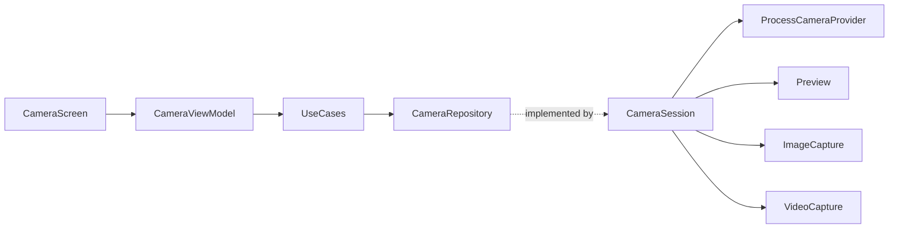

# minimal-camerax

A Play Store camera app in Kotlin, built with [Jetpack CameraX](https://developer.android.com/media/camera/camerax) 1.6.2. It is a small, copyable reference for the library: an iPhone-style camera with **Photo**, **Video**, **LIVE** (a real Apple Live Photo pair) and **DUAL** (both lenses in one picture-in-picture still), in Compose.

The repository is `minimal-camerax`; the installed app is still called **CameraX** (`com.arindam.camerax`) because it is the published listing. The app is not the library — install it, tap through it, and lift the patterns.

[](https://play.google.com/store/apps/details?id=com.arindam.camerax)

[](https://opensource.org/licenses/Apache-2.0)
[](LICENSE)

- [Repository](https://github.com/heyncth/minimal-camerax)
- [Project page](https://arindamxd.github.io/projects/camerax)
- [Privacy policy](https://arindamxd.github.io/projects/camerax/privacy-policy)
- [Author](https://arindamxd.github.io/)

## What this project is

Four things you can capture, one viewfinder:

| Mode | What it demonstrates |
| --- | --- |
| **Photo** | `ImageCapture` stills with flash, timer, tap-to-focus, pinch zoom and 0.5× / 1× / 2× pills; optional Grid; Ultra HDR / RAW / DNG when the device lists them |
| **LIVE** | A real Apple Live Photo: a JPEG whose EXIF Apple MakerNote carries the content identifier, plus an `IMG_*.mov` sibling with `com.apple.quicktime.content.identifier` and a still-image-time track. Rolling 1.5 s pre-roll + 1.5 s post-roll, trimmed on keyframes. Falls back to Android Motion Photo v1 if the pair cannot be written |
| **Video** | `VideoCapture` + `Recorder` with audio, flip while recording, HDR / stabilization / 60 fps when advertised, `.mp4` in the gallery |
| **DUAL** | Both lenses in one PiP still. The **DUAL** chip lives in the Photo top row; simultaneous capture when the device allows it, sequential rebind fallback otherwise. Drag the white outline to move the inset, pinch to resize — it snaps to the nearest corner and the same rect is burned into the still |

`PHOTO · VIDEO` is the whole strip. **LIVE** and **DUAL** are toggles in the top row above it; `DUAL` keeps `PHOTO` lit while it is on, because it is a Photo capture, not a third mode.

What the app deliberately does **not** ship: Slo-mo, live Effects, Panorama, a separate Dual-video mode, manual extension chips, ML Kit overlays. Some of that code still exists behind `CameraSession`, but nothing in the UI reaches it.

Unsupported controls stay hidden rather than failing: no extra lens means no zoom pills, no front+back pair means no DUAL chip, no Ultra HDR format means the setting row is disabled. If preview + photo + video cannot bind together, the session drops video and keeps stills instead of crashing. DUAL always outputs a plain merged JPEG and keeps the surviving single-lens still if the second capture or the merge fails.

## Try it

1. Grant **camera** and **microphone** (microphone is optional hardware; video records audio when granted).
2. Tap **LIVE** in the top row, then the shutter: you get a Live Photo pair. Tap **DUAL** for both lenses at once and drag the white outline to place the inset.
3. Swipe the **PHOTO · VIDEO** strip to switch capture type. The gear opens Settings.
4. One shutter: a white disc for stills, red for video, turning into a stop square while recording.
5. Open the thumbnail to browse, share or delete. A Live Photo shows as one item and plays its clip; videos offer 0.5×–2× playback speed.

## The LIVE pair on disk

Files land in the app pictures directory and are published to `DCIM/CameraX` through MediaStore, so the system gallery sees them too:

```
IMG_20261121_193000.jpg   still, EXIF Orientation + Apple MakerNote
IMG_20261121_193000.mov   clip: content identifier + still-image-time timed track
```

- The identifier is one uppercase UUID written into both halves: MakerNote tag 17 (`0x0011`) in the still, and the QuickTime metadata item in the clip.
- The clip is a normal H.264 `.mov` with a `mebx` box and a `com.apple.quicktime.still-image-time` sample, which is what makes Photos, iCloud and macOS treat the pair as a Live Photo.
- `MotionPhotoTrimmer` cuts `[shutter − 1.5 s, shutter + 1.5 s]` on keyframes (stream copy, no re-encode), and the video is placed on the shutter timestamp.
- `MediaFiles` hides the `.mov` companion from the in-app gallery and `AppleLivePhotoWriter.isLivePhoto(file)` marks the still as LIVE.
- If the Apple write fails, the still is re-muxed as an Android Motion Photo instead — XMP `Camera:MotionPhoto` / `Camera:MotionPhotoPresentationTimestampUs` inserted after the JPEG, with the clip appended — so the capture is never lost.

The rolling pre-roll clip is muted, 720p when the device offers `Quality.HD` (lower fallback otherwise), written to app cache (`motion_preroll/`), restarted every 20 s, and never published — only the trimmed window is kept.

## Architecture

Single `:app` module, package-level Clean Architecture:

```
ui  →  domain  ←  data
```



| Layer | Package | Role |
| --- | --- | --- |
| Presentation | `ui/` | Compose chrome, `CameraViewModel` (UI state, countdown, mode) |
| Domain | `domain/` | Models, `CameraModeCatalog`, `CameraRepository` / `MediaRepository`, use cases (`BindCamera`, `CapturePhoto`, `CaptureDualPhoto`, `StartRecording`, …) |
| Data | `data/camera/` | `CameraSession` — the CameraX implementation, plus `AppleLivePhotoWriter`, `MotionPhotoTrimmer`, `DualPhotoMerger`, `DualComposition` |
| Data | `data/media/` | `FileMediaRepository` — disk + MediaStore on `AppDispatchers.io` |
| Composition root | `di/AppContainer` | Manual DI + `AppDispatchers`; the UI never constructs `CameraSession` |

`CameraFragment` is only a Compose host. Preview is wrapped as `PreviewViewHost` (`CameraHost`) so domain code never imports `PreviewView`.

### Where to look

```
app/src/main/java/com/arindam/camerax/
  domain/model/          CameraMode, CameraModeCatalog (per-mode flags), bind config
  domain/repository/     CameraRepository (+ MediaRepository), SettingsRepository
  domain/usecase/        BindCamera, CapturePhoto, CaptureDualPhoto, StartRecording, …
  data/camera/           CameraSession, AppleLivePhotoWriter, MotionPhotoTrimmer,
                         MotionPhotoMuxer, DualComposition, DualPhotoMerger, StillImageExif
  data/media/            FileMediaRepository, MediaFiles, MediaStorePublisher
  di/                    AppContainer (composition root)
  ui/home/camera/        CameraScreen, CameraChrome, CameraViewModel
  ui/home/gallery/       Photo + video pager
  ui/settings/           SettingsCatalog + SettingsScreen
  ui/compose/            CameraGlassButton, ChromeActionPill (ChromeControlSize = 44.dp)
```

Gallery / Confirm / Settings controls share **`ChromeControlSize` (44dp)**. Full-screen headers use **20dp** side / **8dp** top padding after `safeDrawing` only; the live-feed header follows the same rule — see [Shared chrome components](AGENTS.md#shared-chrome-components) and [Chrome screen insets](AGENTS.md#chrome-screen-insets--header-padding).

## CameraX API map

| Control | API |
| --- | --- |
| Viewfinder | `Preview` + `PreviewView` (`COMPATIBLE` mode, so chrome receives touches) |
| Photo | `ImageCapture`, `CAPTURE_MODE_MAXIMIZE_QUALITY`, Ultra HDR / RAW-JPEG formats when advertised |
| LIVE | Rolling `VideoCapture` + `MotionPhotoTrimmer` + `AppleLivePhotoWriter`; `MotionPhotoMuxer` fallback |
| Video | `VideoCapture` + `Recorder` + `Recording`, `MirrorMode.MIRROR_MODE_ON_FRONT_ONLY` |
| Flash / torch | `ImageCapture.flashMode` + `CameraControl.enableTorch` |
| Zoom pills and pinch | `CameraControl.setZoomRatio` / `ZoomState`; extra back cameras from `availableCameraInfos` |
| Tap to focus | `FocusMeteringAction` on the `PreviewView` transform |
| DUAL still | Non-composition `ConcurrentCamera` with one `ImageCapture` per lens (`SingleCameraConfig`), sequential rebind fallback, merged by `DualPhotoMerger` |
| Night auto-switch (API 36+) | `EXTENSION_NIGHT_MODE_INDICATOR` → `ExtensionsManager` bind. Extensions are programmatic only; there are no extension chips |
| 60 fps video | `SessionConfig` + `GroupableFeature.FPS_60` after `isSessionConfigSupported` |
| Video HDR | `Recorder` supported dynamic ranges → `VideoCapture.Builder.setDynamicRange` |
| Video stabilization | `Preview` / `VideoCapture` stabilization after capability checks |

Copy-paste path for another app: start at [`CameraRepository`](app/src/main/java/com/arindam/camerax/domain/repository/CameraRepository.kt) and [`CameraSession`](app/src/main/java/com/arindam/camerax/data/camera/CameraSession.kt).

## Stack

- Kotlin **2.4.10**, Jetpack Compose (BOM 2026.08.00), CameraX **1.6.2**
- minSdk **23**, target/compileSdk **37** (CameraX itself supports API 21)
- Navigation, ViewModel, Coil
- Optional Firebase / Crashlytics when `app/google-services.json` is present (Analytics collection stays off in the manifest)
- Release: R8 + resource shrinking, native debug symbols (`SYMBOL_TABLE`) for Play Console

## Build

```sh
./gradlew assembleDebug
./gradlew bundleRelease              # Play Store App Bundle (needs signing in local.properties)
./gradlew printNativeDebugSymbols    # after bundleRelease — prints native-debug-symbols.zip path (or if missing)
```

Signing for `bundleRelease` is read from `local.properties` (`storeFile`, `storePassword`, `keyAlias`, `keyPassword`). Release signing applies to the `release` build type only. Do not commit the keystore.

The JDK must be 17+ for the Gradle build; CI and this project are built with JDK 21. Open the project in Android Studio and run the `app` configuration on a device or emulator with a camera.

## Test

```sh
./gradlew testDebugUnitTest          # JVM (Robolectric + fakes)
./gradlew lintDebug                  # Android lint (CI runs this)
./gradlew connectedDebugAndroidTest  # device / emulator via ADB
```

In Android Studio: **Run → Edit Configurations → Add** → `Android JUnit` (Robolectric) or `Android Instrumented Tests`, module `app`, class `com.arindam.camerax.MainInstrumentedTest`.

## Play Store release

See **[RELEASE.md](RELEASE.md)** for the full checklist (version bump, signing, artifacts, upload).

| Artifact | Command / path |
| --- | --- |
| AAB | `./gradlew bundleRelease` → `app/build/outputs/bundle/release/` |
| R8 mapping | `app/build/outputs/mapping/release/mapping.txt` |
| Native symbols | `./gradlew printNativeDebugSymbols` → `app/build/outputs/native-debug-symbols/release/native-debug-symbols.zip` (upload in Play Console if present; some dependency `.so` files have no symbols) |

## Threading

Repositories run disk and MediaStore work on `AppDispatchers.io`; `CameraSession` post-processes captures (trim, mux, merge, EXIF) on its camera executor. ViewModels use `withContext` for metadata, review and gallery probes. Debug builds enable StrictMode (log-only) to catch main-thread disk access. See [AGENTS.md](AGENTS.md).

## Stretch (not in this app yet)

Full photo editor; catalog-style selfie segmentation live overlay; Scan / ML Kit analysis.

## Contributing

Pull requests are welcome against `master`. Follow [CONTRIBUTING.md](CONTRIBUTING.md) and keep the surface small — new modes need a `CameraModeProfile` and a reason to exist.

### Find this project useful?

Star the repo if it helped you ship a camera feature.

### Contact

- [Author](https://arindamxd.github.io/)
- [Twitter](https://twitter.com/arindamxd)
- [LinkedIn](https://in.linkedin.com/in/arindamxd)
- [GitHub](https://github.com/arindamxd)

## License

Copyright 2019-2026 Arindam Karmakar

Licensed under the Apache License, Version 2.0. See [LICENSE](LICENSE).

## Reference

CameraX API usage and patterns take reference from the Android
[camera-samples](https://github.com/android/camera-samples) project.
