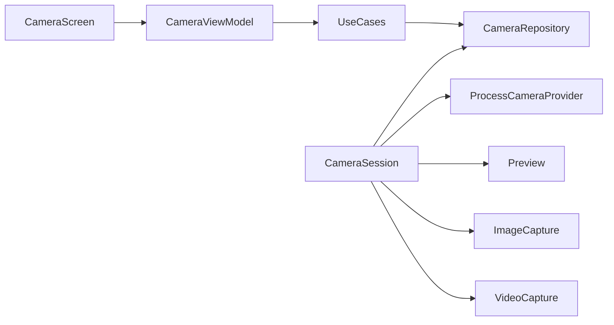

# minimal-camerax

A Play Store camera app in Kotlin, built with [Jetpack CameraX](https://developer.android.com/media/camera/camerax) 1.6. It is a working reference other apps can copy: a minimal iPhone-style camera with Photo, Video, LIVE (a real Apple Live Photo) and DUAL (both lenses in one picture-in-picture still), with a Compose UI.

[](https://play.google.com/store/apps/details?id=com.arindam.camerax)

[](https://opensource.org/licenses/Apache-2.0)
[](LICENSE)

- [Repository](https://github.com/heyncth/minimal-camerax)
- [Project page](https://arindamxd.github.io/projects/camerax)
- [Privacy policy](https://arindamxd.github.io/projects/camerax/privacy-policy)
- [Author](https://arindamxd.github.io/)

## What this project is

The **app** is named CameraX. It is built with the Jetpack **CameraX library** (lifecycle-aware, Camera2 under the hood, API 21+). This repo is the app, not the library — you can install it, tap through it, and copy patterns from it.

| In the app | What it demonstrates |
| --- | --- |
| **Photo** | Still capture with flash, timer, tap-to-focus, pinch zoom, 0.5× / 1× / 2× chips, optional Grid |
| **LIVE** | A real Apple Live Photo pair: JPEG with the Apple MakerNote plus a `.mov` sibling that carries `com.apple.quicktime.content.identifier` and a still-image-time track (1.5 s pre-roll + 1.5 s post-roll) |
| **Video** | Record with audio, flip while recording, video HDR / stabilization / 60 fps when the device lists them, `.mp4` in the gallery |
| **DUAL** | Both lenses in one picture-in-picture still: the **DUAL** chip in the Photo header; simultaneous capture when the device allows it, sequential rebind fallback; the white outline shows where the inset lands — drag it anywhere and it snaps to the nearest corner, pinch to resize |

Unsupported controls stay hidden. If a device cannot bind preview + photo + video together, the camera falls back (drop video, stills only) instead of crashing. DUAL hides unless a front and back camera are listed, always outputs a plain merged JPEG, and keeps the surviving single-lens still if the second capture or the merge fails. LIVE falls back to Android's motion-photo format if the Apple pair cannot be written.

The surface is deliberately small: black viewfinder, system type, yellow `#FFD60A` for the selected mode, a 76dp shutter, and a `PHOTO · VIDEO` strip. Slo-mo, Effects, Panorama and separate Dual-video mode are not part of the product.

## Try it

1. Grant **camera** and **microphone**.
2. Swipe **PHOTO · VIDEO** above the shutter. In **Photo**, tap **LIVE** for a Live Photo, or **DUAL** for both lenses in one still — drag the white PiP outline to place the inset (pinch to resize; it snaps to the nearest corner). The gear opens Settings.
3. Photo shutter is a white disc; video is red and becomes a stop square while recording.
4. Open the thumbnail to browse, share, or delete photos and videos. Live Photos play their clip; gallery videos offer 0.5×–2× playback speed.

## Architecture

Single `:app` module, package-level Clean Architecture:

```
ui  →  domain  ←  data
```



| Layer | Package | Role |
| --- | --- | --- |
| Presentation | `ui/` | Compose chrome, `CameraViewModel` (UI state, countdown, mode) |
| Domain | `domain/` | Models, `CameraRepository`, use cases (`CapturePhoto`, `StartRecording`, `BindCamera`, …) |
| Data | `data/camera/` | `CameraSession` — CameraX implementation of `CameraRepository` |
| Data | `data/media/` | `FileMediaRepository` — disk + MediaStore on `AppDispatchers.io` |
| Composition root | `di/AppContainer` | Manual DI + `AppDispatchers`; UI never constructs `CameraSession` |

`CameraFragment` is only a Compose host. Preview is wrapped as `PreviewViewHost` (`CameraHost`) so domain code does not import `PreviewView`.

### Where to look

```
app/src/main/java/com/arindam/camerax/
  domain/model/          CameraMode, CameraModeCatalog, bind config
  domain/repository/     CameraRepository, MediaRepository
  domain/usecase/        CapturePhoto, StartRecording, BindCamera, …
  data/camera/           CameraSession, AppleLivePhotoWriter, MotionPhotoMuxer,
                         DualComposition, DualPhotoMerger, StillImageExif
  data/media/            FileMediaRepository, MediaStorePublisher
  di/                    AppContainer (composition root)
  ui/home/camera/        CameraScreen, CameraChrome, CameraViewModel
  ui/home/gallery/       Photo + video pager
  ui/settings/           SettingsCatalog + SettingsScreen
  ui/compose/            CameraGlassButton, ChromeActionPill (ChromeControlSize = 44.dp)
```

Gallery / Confirm / Settings controls share **`ChromeControlSize` (44dp)**. Full-screen headers use **20dp** side / **8dp** top padding after `safeDrawing` only — see [AGENTS.md](AGENTS.md#chrome-control-size) and [header padding](AGENTS.md#chrome-screen-insets--header-padding).

## CameraX API map

| Control | API |
| --- | --- |
| Viewfinder | `Preview` + `PreviewView` |
| Photo | `ImageCapture` |
| LIVE (Apple Live Photo) | Rolling `VideoCapture` clip + `MotionPhotoTrimmer` + `AppleLivePhotoWriter` (JPEG EXIF + `.mov`) |
| Video | `VideoCapture` + `Recorder` + `Recording` |
| Flash / torch | `ImageCapture.flashMode` + `CameraControl.enableTorch` |
| Pinch zoom and 0.5 / 1x / 2x chips | `CameraControl.setZoomRatio` / `ZoomState` |
| Tap to focus | `FocusMeteringAction` |
| HDR / Night / Portrait / Beauty | `ExtensionsManager` (`ExtensionMode`) |
| DUAL PiP still | Non-composition `ConcurrentCamera` with an `ImageCapture` per lens (`SingleCameraConfig`), sequential rebind fallback, merged by `DualPhotoMerger` |
| 60 fps video | `SessionConfig` + `GroupableFeature.FPS_60` after `isSessionConfigSupported` |
| Video HDR | `Recorder` supported dynamic ranges → `VideoCapture.Builder.setDynamicRange` |
| Video stabilization | `Preview` / `VideoCapture` stabilization after capability checks |

Copy-paste path for another app: start at [`CameraRepository`](app/src/main/java/com/arindam/camerax/domain/repository/CameraRepository.kt) and [`CameraSession`](app/src/main/java/com/arindam/camerax/data/camera/CameraSession.kt).

## Stack

- Kotlin **2.4.10**, Jetpack Compose, CameraX **1.6.2**
- minSdk **23**, target/compileSdk **37**
- Navigation, ViewModel, Coil
- Optional Firebase / Crashlytics when `app/google-services.json` is present (Analytics collection stays off in the manifest)
- Release: R8 + resource shrinking, native debug symbols (`SYMBOL_TABLE`) for Play Console

## Build

```sh
./gradlew assembleDebug
./gradlew bundleRelease              # Play Store App Bundle (needs signing in local.properties)
./gradlew printNativeDebugSymbols    # after bundleRelease — prints native-debug-symbols.zip path (or if missing)
```

Signing for `bundleRelease` is read from `local.properties` (`storeFile`, `storePassword`, `keyAlias`, `keyPassword`). Release signing applies to the `release` build type only. Do not commit the keystore.

Open the project in Android Studio and run the `app` configuration on a device or emulator with a camera. Microphone is optional hardware (`android.hardware.microphone` is not required).

## Test

```sh
./gradlew testDebugUnitTest     # JVM (Robolectric + fakes)
./gradlew lintDebug             # Android lint (CI runs this)
./gradlew connectedDebugAndroidTest  # device / emulator via ADB
```

In Android Studio: **Run → Edit Configurations → Add** → `Android JUnit` (Robolectric) or `Android Instrumented Tests`, module `app`, class `com.arindam.camerax.MainInstrumentedTest`.

## Play Store release

See **[RELEASE.md](RELEASE.md)** for the full checklist (version bump, signing, artifacts, upload).

Quick paths:

| Artifact | Command / path |
| --- | --- |
| AAB | `./gradlew bundleRelease` → `app/build/outputs/bundle/release/` |
| R8 mapping | `app/build/outputs/mapping/release/mapping.txt` |
| Native symbols | `./gradlew printNativeDebugSymbols` → `app/build/outputs/native-debug-symbols/release/native-debug-symbols.zip` (upload in Play Console if present; some dependency `.so` files have no symbols) |

## Threading

Repositories run disk and MediaStore work on `AppDispatchers.io`. ViewModels use `withContext` for metadata, review, and gallery probes. Debug builds enable StrictMode (log-only) to catch main-thread disk access. See [AGENTS.md](AGENTS.md).

## Stretch (not in this app yet)

Full photo editor; catalog-style selfie segmentation live overlay; Scan / ML Kit analysis.

## Contributing

Pull requests are welcome. Follow [CONTRIBUTING.md](CONTRIBUTING.md) and target the `development` branch.

### Find this project useful?

Star the repo if it helped you ship a camera feature.

### Contact

- [Author](https://arindamxd.github.io/)
- [Twitter](https://twitter.com/arindamxd)
- [LinkedIn](https://in.linkedin.com/in/arindamxd)
- [GitHub](https://github.com/arindamxd)

## License

Copyright 2019-2026 Arindam Karmakar

Licensed under the Apache License, Version 2.0. See [LICENSE](LICENSE).

## Reference

CameraX API usage and patterns take reference from the Android
[camera-samples](https://github.com/android/camera-samples) project.
